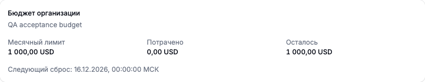
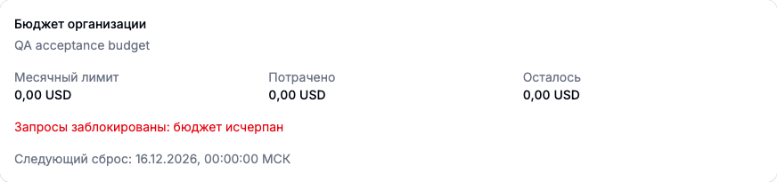

# Daily key budgets and member organization summary

Production target: `pool.fan-fuel.com`, deployment `/root/litellm/docker/exclusive-pool`, two proxy workers with PostgreSQL and shared Redis

Published image: `cr.selcloud.ru/ttkdc/litellm:exclusive-pool-daily-budget-20261116-r2`

Pinned image: `cr.selcloud.ru/ttkdc/litellm@sha256:bc58b4b5cff1554596e251415877ffe3ef44c4bf20b2d70bc86f8eef59d4e23f`

Production source revision: `9cd33294fc`. Feature commits: `a3ffa57d56`, `6ec330b5af`, `ad60ed51ea`, `9cd33294fc`

## Backup and rollback

The prior production image is `cr.selcloud.ru/ttkdc/litellm@sha256:a6ecd7cdbd4dcbfaf1aaae23199922021501a4ae42644f58d03de383114308a9`

Root-only backups are under `/root/litellm-backups/20261116-daily-budget`. `postgres.dump` was restored into an independent validation database and that database was removed. `redis.rdb` passed `redis-check-rdb`. `SHA256SUMS` verifies those files and the configuration archive. Provider model and credential tables match the restored backup. All environment values except the image reference, `pool.json` and `proxy.yaml` are unchanged

Rollback is prepared at `/root/litellm-backups/20261116-daily-budget/rollback.py`. It temporarily refuses new public requests, waits for active pool operations to end, gracefully stops only proxy, restores the prior image digest, waits for liveliness and restores ingress. It preserves PostgreSQL, Redis and pool state. The rollback script was syntax checked; it was not executed after the successful upgrade

```bash
ssh root@82.148.1.68 'python3 /root/litellm-backups/20261116-daily-budget/rollback.py'
```

The final image corrects an acceptance finding in the first candidate: the generic reset helper aligned a new daily key window to UTC midnight. Key daily windows now begin at creation plus 24 hours and advance from the previous anchor; legacy windows and organization schedules keep their existing semantics. The first candidate digest `308a4012…` is superseded

No schema migration or data rewrite is needed. Do not initialize, reconfigure or reset the pool, and do not restore data backups merely to roll back proxy code

## Verification

The backend suite covers policy parsing, inheritance, managed key writes, organization writes, budget APIs, real budget enforcement, both independent worker caches, preserved counters/reset times, pool routing and monthly resets. The final backend result is 1651 passed with 213 warnings. Run logs are `/tmp/daily-budget-r2-tests.log` and `/tmp/daily-budget-ui-final.log` on the build machine. The four final gate logs are `/tmp/daily-r2-ruff.log`, `/tmp/daily-r2-discipline.log`, `/tmp/daily-r2-test-quality.log` and `/tmp/daily-r2-types.log`. The strict Ruff, type discipline, test quality and basedpyright gates are compared with baseline `98d834ef89`; no caps or suppressions were raised

The dashboard production build completed with 56 exported pages. The UI integration suite has eight passing cases covering ordinary members, zero and unlimited ceilings, absent schedule, errors, refresh, membership revocation and session changes. Targeted ESLint and production TypeScript checks pass

## Live acceptance on 2026-11-16

A temporary user was created with global role `internal_user`, ordinary organization membership and team role `admin`. Its password was set through the supported invitation flow and login used `/v2/login`. The browser independently logged in through `/ui/login/`. No administrative key was placed in the browser

The final image was verified again with freshly created resources. A key-generation request ran from `2026-11-16T09:38:14.573779Z` through `09:38:14.647036Z`; the daily reset was `2026-11-17T09:38:14.620959Z`, confirming a full 24-hour first interval. Real inference returned HTTP 200 and `OK`, and native Messages streaming returned HTTP 200 with `message_stop`

All three requested team policies, 30/150, 150/750 and 300/1500 USD, were accepted on `/team/new` and inherited by keys created through the user's dashboard session. A separate legacy team accepted `5h`/`7d`, inherited both limits and completed real inference

The summary returned only the member organization and the eight documented fields. Foreign organization/user query parameters did not expand access; missing authentication returned 401. Removing membership immediately returned an empty summary. General `/organization/info` stayed inaccessible to the client

Legacy and v2 organization update attempts were rejected for changed or null ceilings, schedules, zero spend, metadata and empty payloads. Direct `/budget/update` was rejected. Team policy modification/removal and key create/update overrides, including null/empty values and automatic rotation, were rejected

A real Haiku inference returned HTTP 200 and `OK`. Both persisted key windows accrued the same actual cost and organization spend reflected it. A model outside the team grant returned 403. Organization ceiling zero caused repeated inference requests to return 422 while local login and summary remained available

Deterministic exhaustion used only the temporary key's counters. Daily and weekly exhaustion each returned 422. Updating that team's policy preserved both counters and matching reset timestamps. Worker socket ownership identified PIDs 142 and 143, and both rejected the daily-exhausted key. No real client spend was edited

Native Messages streaming returned HTTP 200 with `message_start`, `content_block_delta` and `message_stop`. The end-user equivalent requests used curl with credentials stored only in root-owned temporary config files:

```bash
curl -sS --config "$QA_KEY_CURL" "$PROXY_URL/v1/chat/completions" \
  --data-binary @inference.json -o response.json -w 'HTTP %{http_code}\n'
curl -sS --config "$QA_KEY_CURL" -H 'anthropic-version: 2023-06-01' \
  "$PROXY_URL/v1/messages" --data-binary @messages.json -o stream.txt -w 'HTTP %{http_code}\n'
```

Both returned HTTP 200. The completion text was `OK`; the stream ended with `message_stop`. These calls reached the configured provider and accrued actual spend

Before cleanup, all 22 prior key rows, 12 prior team rows and four prior organization rows matched the saved baseline, including limits, spend and reset timestamps. The pool fingerprint and retained prior upstream assignments matched. Original ingress configuration was restored

Temporary keys, teams, organizations, budgets, invitation and user were removed through supported APIs. The deleted user's session subsequently returned 401. Temporary credential files were removed. Historical test inference logs remain as audit records

## Screenshots

Open `/ui/login/`, sign in as an ordinary member, then visit `/ui/api-keys/`. The card appears above the key table. The following screenshots show the actual production card under the temporary user's session, cropped to exclude keys and tokens






The API error state was also exercised in the browser by intercepting only the summary response with HTTP 503. It showed the error text and hid the balance. Some unrelated dashboard requests to administrative health/license/plugins/agent endpoints were denied for this ordinary member; summary and key operations remained available

## Bot readiness

The Telegram bot and existing tariffs were not changed. The server accepts `1d`/`7d` team policies and keys inherit them, allowing the separately prepared bot version to be activated after this server release
